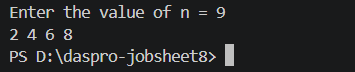
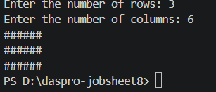
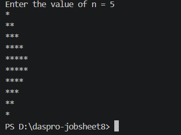
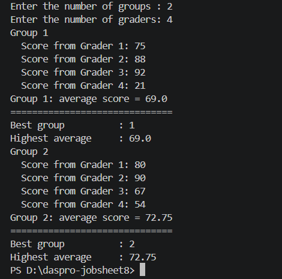
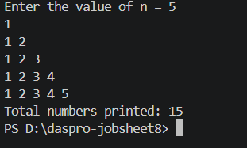
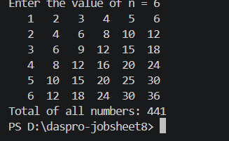
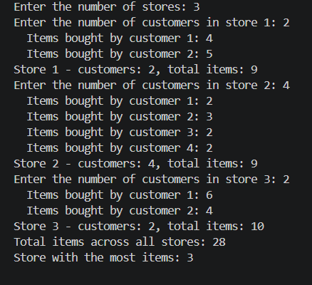

# JOBSHEET 8 - LOOPS 2

## Student Identity

- Name: Wildan Arya Indradiansyah
- Student ID (NIM): 264107020257
- Class / No. Attendance : TI-1I / 30

---

# 1. Objectives

The objectives of this practicum are:

1. Students can understand the concept of nested loops in algorithms.
2. Students can understand the flow of nested loops.
3. Students can recognize the syntax of nested loops.
4. Students can apply nested loops to solve a simple case study.

---

# 2. Labs Activities

## 2.1 Experiment 1: Review of Loops 1

This experiment is a review of the for loop before learning nested loops. The program reads a positive integer n and prints the character \* side by side n times. It uses print, not println, so the stars stay on the same line.

### 2.1.1 Java Program Code

```java
import java.util.Scanner;

public class Star30 {
    public static void main(String[] args) {
        Scanner sc = new Scanner(System.in);
        System.out.print("Enter the value of n = ");
        int n = sc.nextInt();

        for (int i = 1; i <= n; i++) {
            System.out.print("*");
        }
        System.out.println();
        sc.close();
    }
}
```

### 2.1.2 Running Results / Output Screenshot


Expected output (example only, calculated from the code; not yet confirmed by running the program). The number after = is the input.

```text
Enter the value of n = 5
*****
```

For n = 3 the program should print 3 stars (\*\*\*), and for n = 7 it should print 7 stars (\*\*\*\*\*\*\*). (The real numbers from the test runs are to be completed.)

### 2.1.3 Answers to Questions / Reflection Questions

Question 1: If the initialization i = 1 is changed to i = 0 without changing the condition, how many \* characters are printed when n = 5? Explain.

Answer: 6 stars are printed. The loop now starts at i = 0 and still stops after i <= 5, so i becomes 0, 1, 2, 3, 4, and 5. That is 6 rounds, and each round prints one star.

Question 2: If the condition i <= n is changed to i < n, how many times does the loop run when n = 5? Why is the result different?

Answer: The loop runs 4 times, so 4 stars are printed. i starts at 1 and the loop stops as soon as i is 5, because 5 < 5 is false. With <= the value 5 is still included, with < it is not.

Question 3: Predict the output of the following code fragment when n = 9, then verify it by replacing the FOR loop in your program and running it. Modify this code so that it prints the odd positive numbers that do not exceed n.

```java
for (int i = 2; i <= n; i += 2) {
    System.out.print(i + " ");
}
```

Answer: The loop starts at 2 and adds 2 each round, so i becomes 2, 4, 6, and 8. When i is 10, the condition 10 <= 9 is false and the loop stops. The predicted output is:

```text
2 4 6 8 
```

(To be completed - verify this by running the program.)

To print the odd positive numbers, the loop must start at 1. It still adds 2 each round:

```java
for (int i = 1; i <= n; i += 2) {
    System.out.print(i + " ");
}
```


Question 4: Explain why changing the increment i++ to i-- (with the condition still i <= n) makes the loop run endlessly.

Answer: i starts at 1 and gets smaller every round (1, 0, -1, -2, and so on). It is always smaller than n for a positive n, so the condition i <= n never becomes false. The loop keeps printing stars and does not stop in a reasonable time. I did not run this version. If it is started by mistake, it can be stopped with Ctrl + C in the terminal.

---

## 2.2 Experiment 2: Rectangle Star Pattern (Nested FOR)

This experiment prints a rectangle of stars with a nested for loop. The user enters the number of rows and the number of columns. The outer loop controls the rows, and the inner loop controls the columns. For rows = 3 and columns = 6, the output is 3 lines with 6 stars each.

### 2.2.1 Java Program Code

```java
import java.util.Scanner;

public class Rectangle30 {
    public static void main(String[] args) {
        Scanner sc = new Scanner(System.in);
        System.out.print("Enter the number of rows: ");
        int rows = sc.nextInt();
        System.out.print("Enter the number of columns: ");
        int columns = sc.nextInt();

        for (int i = 1; i <= rows; i++) {
            for (int j = 1; j <= columns; j++) {
                System.out.print("*");
            }
            System.out.println();
        }
        sc.close();
    }
}
```

### 2.2.2 Running Results / Output Screenshot


### 2.2.3 Answers to Questions / Reflection Questions

Question 1: Explain the function of the variables i and j in the program.

Answer: i is the counter of the outer loop. It counts the rows, so it decides how many lines are printed. j is the counter of the inner loop. It counts the stars in one row, so it decides how many stars are printed on each line.

Question 2: How many times are the outer loop, the inner loop, and the statement print("\*") executed for rows = 4 and columns = 7?

Answer: The outer loop runs 4 times. The inner loop runs 7 times for each round of the outer loop, so it runs 4 x 7 = 28 times in total. The statement print("\*") is inside the inner loop, so it is executed 28 times.

Question 3: What happens if the bounds of the outer and inner loops are swapped (the outer loop uses columns and the inner loop uses rows)? Use rows = 3 and columns = 6 to explain.

Answer: The outer loop would run 6 times and the inner loop would run 3 times in each round. The program would print 6 lines with 3 stars each, not 3 lines with 6 stars. The shape turns around (6 rows and 3 columns). The total number of stars is still 18.

Question 4: Explain the effect of removing System.out.println(); after the inner loop.

Answer: The cursor never moves to a new line, so all the stars are printed on one single line. For rows = 3 and columns = 6, the output would be 18 stars in a row (\*\*\*\*\*\*\*\*\*\*\*\*\*\*\*\*\*\*), not a rectangle.

Question 5: Modify the program so that the printed character is #, then commit and push the changes to GitHub.

Answer: Only the character inside print is changed:

```java
for (int i = 1; i <= rows; i++) {
    for (int j = 1; j <= columns; j++) {
        System.out.print("#");
    }
    System.out.println();
}
```


---
## 2.3 Experiment 3: Debugging a Star Triangle - Nested WHILE

The starter code in this experiment does not print the correct triangle on purpose. The task is to find the errors and fix them without changing the while loops into for loops. The target output for n = 5 is a triangle that grows from 1 star to 5 stars. After it works, the program also prints an inverted triangle.

### 2.3.1 Java Program Code

Starter code (with errors):

```java
import java.util.Scanner;

public class Triangle30 {
    public static void main(String[] args) {
        Scanner sc = new Scanner(System.in);
        System.out.print("Enter the value of n = ");
        int n = sc.nextInt();

        int i = 0;
        while (i <= n) {
            int j = 0;
            while (j < i) {
                System.out.print("*");
                j++;
            }
            i++;
        }
        sc.close();
    }
}
```

Fixed code (triangle and inverted triangle, debug line removed):

```java
import java.util.Scanner;

public class fixTriangle30 {
    public static void main(String[] args) {
        Scanner sc = new Scanner(System.in);
        System.out.print("Enter the value of n = ");
        int n = sc.nextInt();

        // Triangle
        int i = 1;                       // fix: start from 1, not 0
        while (i <= n) {
            int j = 0;
            while (j < i) {
                System.out.print("*");
                j++;
            }
            System.out.println();        // fix: move to a new line after each row
            i++;
        }

        // Inverted triangle
        i = n;                           // no "int", because i is already declared
        while (i >= 1) {
            int j = 0;
            while (j < i) {
                System.out.print("*");
                j++;
            }
            System.out.println();
            i--;
        }
        sc.close();
    }
}
```

### 2.3.2 Running Results / Output Screenshot

output without the temporary debug line System.out.print("[i=" + i + "] "); for n = 5 :


output with the temporary debug line System.out.print("[i=" + i + "] "); for n = 5 :




### 2.3.3 Answers to Questions / Reflection Questions

Question 1: Identify the mismatches in the initial output, and at least two fixes needed to produce a nested triangle pattern.

Answer: There are two mismatches. First, all the stars are printed on one line because there is no line break. Second, the outer loop runs n + 1 times, so the first row has 0 stars (an empty row). The two fixes are:

1. Add System.out.println(); after the inner loop (before i++), so each row is on a new line.
2. Change the start of the outer loop from int i = 0; to int i = 1;, so the loop runs exactly n times.

Question 2: Explain the roles of the variables i and j. Why must the value of j be reset to 0 in every iteration of the outer loop? What happens if j is not reset?

Answer: i is the row number, and it is also how many stars the current row must have. j counts the stars that have been printed in the current row.
j must go back to 0 at the start of every row, because each row needs to count its stars from the beginning. If j is not reset, it keeps the value from the last row. Then j < i is only true one time in each new row, so every row after the first prints just 1 star.

Question 3: Explain the changes to the initialization, the condition, and the update of the outer loop that are needed to form the inverted triangle.

Answer: For the inverted triangle, the outer loop must go from big to small. The initialization changes from i = 1 to i = n, so the first row has n stars. The condition changes from i <= n to i >= 1, so the loop stops after the row with 1 star. The update changes from i++ to i--, so each row has one star less than the row before.

---
## 2.4 Experiment 4: Case Study of Group Project Scores

In a group project, each group gets scores from several graders. The program reads the number of groups and the number of graders (the same for every group), then calculates the average score of each group and finds the group with the highest average. The program does not store all the scores. It uses three loops: a while loop (outer) for the groups, a for loop (middle) for the graders, and a do-while loop (inner) to ask again when a score is invalid (not between 0 and 100).

### 2.4.1 Java Program Code

The job sheet leaves the if block in step 7 for the student to complete. The two lines inside it were written by me.

```java
import java.util.Scanner;

public class GroupScore30 {
    public static void main(String[] args) {
        Scanner sc = new Scanner(System.in);

        System.out.print("Enter the number of groups : ");
        int numGroups = sc.nextInt();
        System.out.print("Enter the number of graders: ");
        int numGraders = sc.nextInt();

        if (numGroups <= 0 || numGraders <= 0) {
            System.out.println("Groups and graders must be > 0.");
        } else {
            int groupNo = 1;                 // outer loop counter
            double highestAverage = -1;      // -1: the first group is recorded
            int bestGroup = 0;

            while (groupNo <= numGroups) {
                System.out.println("Group " + groupNo);
                double totalScore = 0;

                // inner loops over graders
                for (int j = 1; j <= numGraders; j++) {
                    int score;
                    do {
                        System.out.print("  Score from Grader " + j + ": ");
                        score = sc.nextInt();
                        if (score < 0 || score > 100) {
                            System.out.println("  Score must be 0-100. Retry!");
                        }
                    } while (score < 0 || score > 100);
                    totalScore += score;
                }

                double averageScore = totalScore / numGraders;
                System.out.println("Group " + groupNo
                        + ": average score = " + averageScore);

                if (averageScore > highestAverage) {
                    highestAverage = averageScore;
                    bestGroup = groupNo;
                }

                groupNo++;
            }

            System.out.println("==============================");
            System.out.println("Best group          : " + bestGroup);
            System.out.println("Highest average     : " + highestAverage);
        }
        sc.close();
    }
}
```

### 2.4.2 Running Results / Output Screenshot



### 2.4.3 Answers to Questions / Reflection Questions

Question 1: Why must totalScore be reset inside the outer loop, but highestAverage must not be reset for each group?

Answer: totalScore belongs to one group only. If it is not reset to 0 at the start of each group, the scores of the next group are added to the old total, and the average becomes wrong. highestAverage must remember the best average from all the groups that were already checked. If it is reset for every group, the old best value is lost, and the last group would always look like the best group.

Question 2: For 3 groups and 2 graders (without any invalid input), how many times is the body of the FOR loop executed in total?

Answer: The FOR loop runs 2 times for each group, and there are 3 groups, so the body is executed 3 x 2 = 6 times in total.

Question 3: What happens if totalScore is declared as int and the average is calculated using integer division? Give an example of values.

Answer: The part after the decimal point is cut off, so the average is not exact. For example, if a group gets 80 and 85, the total is 165 and 165 / 2 gives 82, not 82.5. Even though averageScore is a double, it would only show 82.0. This can also give a wrong best group when two averages are close to each other.

Question 4: Why is highestAverage given the initial value -1 rather than 0? Give an example of input that produces a wrong result if the initial value were 0.

Answer: A score can be 0, so an average can also be 0. With -1, the first group is always bigger than the starting value, so it is always recorded. If the initial value were 0, a group with an average of 0 would never be recorded, because 0 > 0 is false. For example, with 2 groups and 2 graders where every score is 0, bestGroup would stay 0, which is not a real group.

Question 5: This program has three levels of loops. Name each type of loop and its role.

Answer: The outer loop is a while loop, and it processes the groups one by one. The middle loop is a for loop, and it reads the score from each grader of the current group. The inner loop is a do-while loop, and it asks for the same score again as long as the score is outside the range 0 to 100.

---
# 3. Assignment

Time: 120 minutes

## 3.1 Task 1: Nested Number Pattern

The program reads an integer n (at least 1) and prints a number pattern. Row 1 prints 1, row 2 prints 1 2, and so on up to row n. After the pattern, the program shows the total number of digits that were printed. The program assumes that the input n is at least 1, as the job sheet says.

### 3.1.1 Java Program Code

```java
import java.util.Scanner;

public class Task130 {
    public static void main(String[] args) {
        Scanner sc = new Scanner(System.in);

        System.out.print("Enter the value of n = ");
        int n = sc.nextInt();

        int totalNumbers = 0;

        for (int i = 1; i <= n; i++) {
            for (int j = 1; j <= i; j++) {
                System.out.print(j + " ");
                totalNumbers++;
            }
            System.out.println();
        }

        System.out.println("Total numbers printed: " + totalNumbers);
        sc.close();
    }
}
```
### 3.1.2 Running Results / Output Screenshot



---

## 3.2 Task 2: Multiplication Table

The program reads n (at least 3) and prints an n x n multiplication table. Each position shows the row number times the column number. At the end, the program shows the sum of all numbers in the table.

### 3.2.1 Java Program Code

```java
import java.util.Scanner;

public class Task230 {
    public static void main(String[] args) {
        Scanner sc = new Scanner(System.in);

        System.out.print("Enter the value of n = ");
        int n = sc.nextInt();

        int total = 0;

        for (int i = 1; i <= n; i++) {
            for (int j = 1; j <= n; j++) {
                int result = i * j;
                System.out.printf("%4d", result);
                total += result;
            }
            System.out.println();
        }

        System.out.println("Total of all numbers: " + total);
        sc.close();
    }
}
```

### 3.2.2 Running Results / Output Screenshot



---

## 3.3 Task 3: Sales Recap for Several Stores

A shopping center has several stores. The program asks for the number of stores (at least 1), then for each store the number of customers, and for each customer the number of items bought. The number of customers and items can be 0, but not negative. The program shows the number of customers and total items for each store, the total items of all stores, and the number of the store with the most items. If two stores have the same highest total, the store with the smaller number is shown.

### 3.3.1 Java Program Code

```java
import java.util.Scanner;

public class Task330 {
    public static void main(String[] args) {
        Scanner sc = new Scanner(System.in);

        System.out.print("Enter the number of stores: ");
        int numStores = sc.nextInt();

        if (numStores < 1) {
            System.out.println("The number of stores must be at least 1.");
        } else {
            int totalAllItems = 0;
            int mostItems = -1;      // -1: the first store is always recorded
            int bestStore = 0;
            int storeNo = 1;

            while (storeNo <= numStores) {
                int numCustomers;
                do {
                    System.out.print("Enter the number of customers in store " + storeNo + ": ");
                    numCustomers = sc.nextInt();
                    if (numCustomers < 0) {
                        System.out.println("Must not be negative. Retry!");
                    }
                } while (numCustomers < 0);

                int storeItems = 0;

                for (int c = 1; c <= numCustomers; c++) {
                    int items;
                    do {
                        System.out.print("  Items bought by customer " + c + ": ");
                        items = sc.nextInt();
                        if (items < 0) {
                            System.out.println("  Must not be negative. Retry!");
                        }
                    } while (items < 0);
                    storeItems += items;
                }

                System.out.println("Store " + storeNo + " - customers: " + numCustomers
                        + ", total items: " + storeItems);

                totalAllItems += storeItems;

                if (storeItems > mostItems) {
                    mostItems = storeItems;
                    bestStore = storeNo;
                }

                storeNo++;
            }

            System.out.println("Total items across all stores: " + totalAllItems);
            System.out.println("Store with the most items: " + bestStore);
        }
        sc.close();
    }
}
```

### 3.3.2 Running Results / Output Screenshot

